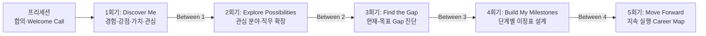

# Dream Milestone Program Guide
## 대학생·대학원생 맞춤형 5회기 다회기 커리어 코칭 프로그램 공식 가이드북

> **핵심 철학**: 코칭은 문제를 대신 해결하거나 진로를 처방하는 과정이 아니라, 학생이 자신의 삶과 커리어에서 주체적인 선택을 내리고 작은 행동 실험(Action Experiment)과 성찰을 통해 스스로 길을 설계·검증하도록 파트너링하는 과정이다.

---

# 탭 1. 개요 (Program Overview)

## 1.1 프로그램 정의 및 운영 사양

**Dream Milestone**은 전공 적합성, 직무 탐색, 연구·취업 간 갈등, 비교 불안으로 고민하는 대학생·대학원생이 자신만의 커리어 기준(`Strength & Value`)을 세우고, 현실적인 이정표(`Milestone`)를 설계하며, 실제 행동(`Action`)으로 가설을 검증하도록 지원하는 **5회기 다회기 커리어 코칭 프로그램**이다.

| 구분 | 표준 운영 사양 |
| :--- | :--- |
| **주관 / 대상** | 삼성코칭동호회(SCC) 코치 / 대학생·대학원생·초기 취준생 |
| **운영 형태** | 1:1 코칭 기본 (필요 시 소그룹 보조 운영) |
| **세션 구성** | 프리세션(15분 Welcome Call) + 본 세션 5회기(회기당 60분) |
| **회기 간격** | 1~2주 간격 권장 (회기 사이 30~90분 규모의 Action Experiment 수행) |
| **기록 및 보안** | 코칭일지(구글폼)와 학생 워크북 분리 관리, 실명 대신 학생 코드 사용(최소 개인정보) |

---

## 1.2 4대 운영 원칙 및 SHARE 프로토콜

| 원칙 | 핵심 정의 | 코치의 실천 행동 | 피해야 할 행동 (Anti-Pattern) |
| :--- | :--- | :--- | :--- |
| **1. Coaching First** | 학생 스스로 답과 가능성을 발견하도록 파트너링 | 열린 질문·경청·반영을 우선하고 학생이 자기 언어로 목표와 행동을 선택하게 함 | 고민을 듣자마자 해결책·진로를 먼저 처방함 |
| **2. Experience on Demand** | 요청·동의 시에만 코치의 실무 경험/정보를 보조 지원 | SHARE 프로토콜에 따라 짧게 공유 후 선택권을 즉시 학생에게 반환 | 코치의 성공 사례를 정답처럼 강요하거나 일방 훈수 |
| **3. Action & Reflection** | 세션 내 대화 + 세션 간 실제 행동·성찰 순환 | 작고 검증 가능한 실험을 설계하고 실행·미실행 모두에서 배움 추출 | 숙제 검사처럼 미실행을 질책하거나 대화로만 종료 |
| **4. Guide, not Script** | 대본이 아닌 전문적 판단을 지원하는 유연한 가이드 | 학생의 속도·정서·의제에 맞춰 질문, 순서, 코칭 도구를 유연하게 재구성 | 학생 흐름을 끊고 매뉴얼 질문을 기계적으로 낭독 |

### Experience on Demand 실행 5단계 (SHARE)
1. **S (Seek Permission — 동의 확인)**: `"질문으로 더 탐색하는 것과 제 실무 경험을 2분 정도 참고로 듣는 것 중 무엇이 도움이 될까요?"`
2. **H (Highlight Context — 맥락 명시)**: `"제 경우에는 당시 산업 환경과 배경이 이러했습니다(일반화 금지)."`
3. **A (Add One Insight — 핵심 1가지 공유)**: `"그때 얻은 핵심 배움 한 가지는 완벽한 준비보다 작은 프로젝트 검증이었습니다."`
4. **R (Return Choice — 선택권 반환)**: `"이 이야기 중 본인 상황에 참고할 부분과 다르게 느껴지는 부분은 무엇인가요?"`
5. **E (Explore Action — 행동 연결)**: `"그렇다면 이번 주 본인만의 방식으로 확인해 볼 작은 실험은 무엇일까요?"`

---

## 1.3 5회기 표준 운영 모델 매트릭스

| 회기 | 주요 초점 (Theme) | 핵심 탐색 질문 | 학생 산출물 (Deliverables) | 연동 폼 |
| :--- | :--- | :--- | :--- | :--- |
| **프리세션** | **Preparation & Agreement** | `"5회기를 마칠 때 무엇이 선명해지면 좋을까?"` | `사전 질문지` | - |
| **1회기** | **Discover Me** (경험·강점·가치·관심) | `"나는 어떤 순간에 몰입하며 무엇을 중요하게 여기는가?"` | `My Strength & Value Map` | 코칭일지 1 |
| **2회기** | **Explore Possibilities** (가능성 확장) | `"내 강점과 가치가 살아날 수 있는 분야·직무는 무엇인가?"` | `Career Possibility Map` | 코칭일지 2 |
| **3회기** | **Find the Gap** (현재-목표 Gap 탐색) | `"원하는 미래와 현재 사이에서 무엇을 확인·보완해야 하는가?"` | `Current-Future Gap Map` | 코칭일지 3 |
| **4회기** | **Build My Milestones** (이정표 설계) | `"다음 장면으로 가기 위해 밟을 현실적 이정표와 대안은?"` | `Career Milestone` | 코칭일지 4 |
| **5회기** | **Move Forward** (실행계획·지속 약속) | `"코칭 종료 후에도 어떤 시스템으로 내 길을 이어갈 것인가?"` | `Action Plan + My Dream Milestone Career Map` | 코치/학생 성과평가 |

---

## 1.4 기대 성과 및 성과평가 체계

사전·사후 동일 척도(5점 척도 + 서술형 성찰)로 측정하며, 등급화가 아닌 학생의 성장 확인과 프로그램 개선에 활용한다.

| 대상 | 핵심 지표 (KPI) | 평가 및 확인 기준 |
| :--- | :--- | :--- |
| **학생 (멘티)** | **1. 코칭 만족도** | 코칭 관계의 심리적 안전감, 경청·존중 체감, 전반적 만족도 |
| **학생 (멘티)** | **2. 자기이해 증진** | 강점·가치·관심·에너지 패턴 및 제약조건을 자기 언어로 설명 가능 여부 |
| **학생 (멘티)** | **3. 커리어 명료화** | 탐색할 진로 방향, 선택 기준, 단계별 이정표의 구체화 정도 |
| **학생 (멘티)** | **4. 실제 Action 경험** | 회기 간 Action Experiment 실행·기록·성찰을 통한 진로 가설 검증 경험 |
| **학생 (멘티)** | **5. 자기효능감 및 지속성** | 막히는 상황에서도 작게 시작·조정하며 종료 후에도 지속 실천할 자신감 |
| **코치 (멘토)** | **1. 프로그램 운영 만족도** | 5회기 구조, 가이드북, 워크시트의 실효성 및 운영 만족도 |
| **코치 (멘토)** | **2. 코칭 자신감 확보** | 학생 주도성을 지키며 질문·경청·행동 설계를 수행하는 자신감 향상도 |
| **코치 (멘토)** | **3. 재참여 및 추천 의향** | 차기 기수 코치 재참여 의향 및 동료 코치 추천 의향 |

---

## 1.5 코칭 윤리, 안전 및 역할 경계

- **비밀보장**: 세션 내용은 학생 동의 없이 외부(학교, 지도교수, 가족 등)에 절대 공유하지 않는다. 단, 자·타해 위험 등 중대한 안전 위기 시 기관 보호 절차를 우선한다.
- **역할 경계**: 코치는 심리치료사, 취업 알선자, 지도교수가 아니다. 심각한 우울·정서 위기 징후 발견 시 전문 심리상담기관 연계를 안내한다.
- **기록 원칙**: 코칭일지에는 판단적 표현이나 민감 개인식별정보를 배제하고 사실·통찰·합의된 실험 중심으로 기록한다.

---

# 탭 2. 코칭모델 (Coaching Model)

## 2.0 회기 공통 5단계 인터랙티브 프레임 (60분 기준)

모든 본 세션(1~5회기)은 아래 5단계 표준 탭 구조를 기반으로 학생의 속도에 맞춰 유연하게 운영한다.

| 단계 | 권장 시간 | 핵심 목적 | 코치 핵심 체크포인트 |
| :--- | :---: | :--- | :--- |
| **1. 도입 (Intro)** | 10분 | 라포·컨디션 확인, 이전 실험 회고, 오늘의 의제·기대 결과 합의 | 학생이 오늘의 초점과 원하는 결과를 자기 언어로 정했는가? |
| **2. 탐색 (Explore)** | 15분 | 경험·사실·감정·가치·자원을 구체적 장면 중심으로 경청 | 코치의 해석이나 평가 없이 학생의 언어가 중심이 되었는가? |
| **3. 심화 (Deepen)** | 15분 | 반복 패턴·핵심 의미·선택 기준 자각 및 회기 산출물 구조화 | 통찰이나 키워드를 코치가 대신 결론 내리지 않았는가? |
| **4. 실행설계 (Action)** | 12분 | 다음 회기 전 가설을 검증할 작고 현실적인 Action Experiment 설계 | 행동이 학생 소유이며 실행 가능성(0~10점 중 7점 이상)이 확인되었는가? |
| **5. 마무리 (Close)** | 8분 | 오늘의 핵심 통찰 한 문장 정리, 산출물·기록 방식 확인 | 오늘 가져갈 의미와 다음 실험이 명료하게 합의되었는가? |

---

## 2.1 프리세션 (Pre-Session)

- **목적**: 첫 만남의 긴장을 낮추고 프로그램 원칙·비밀보장·역할에 합의하며 1회기 탐색 재료를 준비한다.

### 1) 학생 사전 질문지 및 코치 검토 기준
1회기 최소 24시간 전 사전 질문지를 검토하며 단정적 진단을 피하고 탐색 단서를 포착한다.

| 사전 질문 항목 | 학생 질문 내용 | 코치 검토 및 1회기 활용 원칙 |
| :--- | :--- | :--- |
| **현재 고민** | 지금 학업·연구·진로에서 가장 자주 떠오르는 고민이나 막막한 질문 1가지는? | 반복 단어와 정서 파악 → 1회기 도입 의제로 그대로 반영 |
| **기대 결과** | 5회기가 끝났을 때 나에게 어떤 변화나 결과물이 남으면 좋겠나요? | 컨설팅/자소서 첨삭 기대 시 Welcome Call에서 `Coaching First` 조율 |
| **경험 자산** | 최근 2~3년간 기억에 남는 경험 3가지와 시간 가는 줄 몰랐던 몰입 경험 1가지는? | 사건의 규모보다 학생이 부여한 의미와 에너지 변화에 주목 |
| **대화 선호** | 코치에게 바라는 대화 방식이나 조심해 주었으면 하는 주제가 있나요? | 민감 영역 존중 및 심리적 안전감 확보 |

### 2) 15분 Welcome Call 진행 가이드

| 시간 | 단계 | 핵심 진행 내용 및 가이드 멘트 |
| :---: | :--- | :--- |
| **0~3분** | **환영 및 라포** | `"반갑습니다. 5회기 여정을 함께할 코치 OOO입니다. 이 시간은 서로의 역할과 진행 방식을 편하게 맞추는 짧은 만남입니다."` |
| **3~7분** | **원칙·비밀보장 합의** | `"이 과정은 제가 정답을 정해드리는 자리가 아니라, 본인만의 기준과 이정표를 찾도록 돕는 파트너십입니다. 필요 시 제 경험을 짧게 나눌 수 있지만 선택은 언제나 본인이 합니다. 모든 대화는 비밀이 보장됩니다."` |
| **7~11분** | **사전 질문지·기대 확인** | `"사전 질문지에 적어주신 '___' 부분이 인상 깊었습니다. 5회기를 마칠 때 무엇이 가장 선명해지면 좋을지 1회기에서 함께 다뤄봅시다."` |
| **11~15분** | **1회기 준비 및 일정 확정** | `"1회기 전까지 기억에 남는 경험 3가지만 편하게 떠올려 와 주세요."` (일시, 접속 링크/장소, 연락 채널 확정) |

---

## 2.2 1회기: Discover Me (경험·강점·가치·관심 탐색)

- **회기 목표**: 과거 경험을 스펙이 아닌 스토리로 재해석하여 고유한 **강점·가치·관심 패턴**을 발견하고 현재의 커리어 질문을 명료화한다.
- **학생 산출물**: `My Strength & Value Map`

### 5단계 세션 가이드 (60분)

| 단계 | 시간 | 핵심 코칭 질문 | 공감 가이드 & 코치 체크포인트 |
| :--- | :---: | :--- | :--- |
| **1. 도입** | 10분 | • `"오늘 1회기 자리에 어떤 마음과 컨디션으로 오셨나요?"` • `"오늘 60분 대화가 끝났을 때 나에 대해 무엇이 조금 더 선명해지면 좋겠나요?"` | • *공감*: `"처음이라 막막하거나 긴장되는 마음은 아주 자연스럽습니다."` • *체크*: 학생이 오늘의 탐색 초점을 직접 설정했는가? |
| **2. 탐색** | 15분 | • `"기억에 남는 경험 2~3가지 중 시간 가는 줄 모르고 몰입했거나 에너지가 올랐던 순간은 언제였나요?"` • `"그때 구체적으로 어떤 행동을 했고, 반대로 유난히 에너지가 빠졌던 순간은 언제였나요?"` | • *공감*: `"그 장면에서 ___가 크게 다가왔군요. 당시의 생생한 에너지가 전해집니다."` • *체크*: 스펙 평가가 아닌 구체적 장면(사실+감정)으로 경청했는가? |
| **3. 심화** | 15분 | • `"여러 경험에서 반복적으로 드러나는 나다운 방식(강점)은 무엇인가요?"` • `"그 일이 의미 있었던 이유는 어떤 가치가 지켜졌기 때문일까요?"` • `"타인의 기준을 잠시 내려놓는다면 지금 더 탐색해 보고 싶은 관심은 무엇인가요?"` | • *공감*: `"이야기 속에서 '___'라는 키워드가 반복해서 빛나고 있네요."` • *체크*: 코치가 명명하지 않고 학생이 직접 강점·가치 단어를 골랐는가? |
| **4. 실행설계** | 12분 | • `"오늘 발견한 강점·가치·에너지 순간을 이번 주 일상에서 어떻게 관찰해 볼까요?"` • `"부담 없이 실행하려면 기록 방식을 얼마나 간단하게 만들면 좋을까요?"` | • *공감*: `"잘해내려는 숙제가 아니라 나를 관찰하는 가벼운 실험이면 충분합니다."` • *체크*: 관찰 횟수·방식이 구체적이고 작게 설계되었는가? |
| **5. 마무리** | 8분 | • `"오늘 내가 나 자신에 대해 새롭게 알게 된 한 문장은 무엇인가요?"` • `"초안으로 만든 My Strength & Value Map을 보니 어떤 느낌이 드나요?"` | • *공감*: `"첫 시간부터 자신의 이야기를 솔직하게 펼쳐주셔서 감사합니다."` • *체크*: 산출물 초안과 Between Session 1 실험이 명료한가? |

### [산출물 템플릿] My Strength & Value Map

| 기억에 남는 경험 장면 | 내가 한 구체적 행동 | 에너지가 올라간 이유 | 드러난 강점 (Strength) | 중요하게 여긴 가치 (Value) | 더 탐색할 관심 (Interest) |
| :--- | :--- | :--- | :--- | :--- | :--- |
| | | | | | |

### Between Session 1: Action Experiment (에너지·강점 일상 관찰)
- **실험 과제**: 1주일간 에너지가 높거나 낮았던 순간을 **3회 이상** 짧게 기록하고 `My Strength & Value Map`을 보완한다.
- **기록 공식**: `무엇을 했나 / 누구와 있었나 / 어떤 강점·가치가 작동했나 / 다음에도 해보고 싶은가`

### 🔗 외연 연동 CTA: [1회기 코칭일지 작성하기 (구글폼 링크)]
- **코치 기록 항목**: 학생 코드/일자, 합의된 의제, 주요 경험 장면 및 학생이 발견한 강점·가치·관심 키워드, 합의된 Action Experiment, 코치 자기성찰(조언 욕구 관리·놓친 신호).

---

## 2.3 2회기: Explore Possibilities (관심 분야·직무·가능성 확장)

- **회기 목표**: 1회기의 자기이해 단서를 다양한 관심 분야·직무·환경·역할과 연결하여 **탐색할 만한 가능성의 지도**를 넓힌다.
- **학생 산출물**: `Career Possibility Map`

### 5단계 세션 가이드 (60분)

| 단계 | 시간 | 핵심 코칭 질문 | 공감 가이드 & 코치 체크포인트 |
| :--- | :---: | :--- | :--- |
| **1. 도입** | 10분 | • `"지난주 에너지·강점 관찰 기록에서 새롭게 눈에 들어온 장면은 무엇인가요?"` • `"(미실행 시) 기록하기 어려웠던 한 주간의 리듬이 알려주는 신호는 무엇일까요?"` • `"오늘 2회기에서 어떤 가능성의 문을 넓혀보고 싶나요?"` | • *공감*: `"관찰하려고 의식해 본 것 자체가 중요한 데이터입니다."` • *체크*: 실행 여부를 평가하지 않고 배움으로 다루었는가? |
| **2. 탐색** | 15분 | • `"직업명 대신 '다루고 싶은 문제', '돕고 싶은 대상', '일하고 싶은 환경'으로 말한다면 어떤 모습인가요?"` • `"1회기에서 찾은 강점과 가치를 전공 안팎의 다양한 영역에 연결한다면 어떤 후보들이 떠오르나요?"` | • *공감*: `"전공이라는 틀을 잠시 넓히니 훨씬 다양한 선택지가 보이기 시작하네요."` • *체크*: 한 가지 정답으로 좁히지 않고 충분히 확장했는가? |
| **3. 심화** | 15분 | • `"떠오른 가능성 중 우선 탐색해 보고 싶은 2~3가지는 무엇인가요?"` • `"각 가능성에서 끌리는 이유(매력)와 아직 모르는 부분(확인할 가설)은 무엇인가요?"` | • *공감*: `"지금은 평생 직업을 확정하는 게 아니라 탐색할 가설 지도를 그리는 단계입니다."` • *체크*: 실무 정보 제공 시 SHARE 프로토콜(동의 후 짧은 공유)을 준수했는가? |
| **4. 실행설계** | 12분 | • `"지도 위의 가설을 머릿속 고민이 아닌 현실 정보·경험으로 확인할 가장 작은 행동은 무엇일까요?"` • `"누제·언제·어떤 경로(JD 분석, 현직자 대화, 아티클 분석 등)로 확인해 볼까요?"` | • *공감*: `"커피챗이 부담스럽다면 채용공고 3건을 비교해 질문 3개를 뽑는 것부터 시작해도 좋습니다."` • *체크*: 1~2주 내 즉시 실행 가능한 검증 실험인가? |
| **5. 마무리** | 8분 | • `"Career Possibility Map을 그려보며 진로를 바라보는 시야가 어떻게 달라졌나요?"` • `"이번 실험을 통해 가장 확인하고 싶은 질문 한 가지는 무엇인가요?"` | • *공감*: `"막연한 고민이 구체적인 탐색 후보들로 정리되니 훨씬 주도적인 에너지가 느껴집니다."` • *체크*: 3회기(Gap 탐색)와의 연결고리를 안내했는가? |

### [산출물 템플릿] Career Possibility Map

| 가능성 영역 (분야·직무·환경) | 끌리는 이유 & 연결되는 강점·가치 | 현재 알고 있는 사실 | 검증이 필요한 가설 (우려/의문) | 다음 탐색 행동 (Action) |
| :--- | :--- | :--- | :--- | :--- |
| **후보 1** | | | | |
| **후보 2** | | | | |
| **후보 3** | | | | |

### Between Session 2: Action Experiment (가능성 가설 검증 실험)
- **실험 과제**: 우선 탐색 후보 1~2개에 대해 아래 중 학생이 선택한 행동 1~2가지를 실행한다.
  - 채용공고·직무기술서(JD) 3건 비교 분석 및 공통 요구 역량 추출
  - 관심 직무 현직자 인터뷰 / 졸업 선배 커피챗 1회 (또는 직무 인터뷰 콘텐츠 2편 심층 요약)
  - 관련 수업·학회·프로젝트·공모전의 작은 역할 체험 후 `"생각과 달랐던 점 / 더 끌린 점 / 다음 질문"` 기록

### 🔗 외연 연동 CTA: [2회기 코칭일지 작성하기 (구글폼 링크)]
- **코치 기록 항목**: 학생 코드/일자, 1회기 실험 회고 배움, 확장된 가능성 후보 2~3개 및 핵심 가설, Experience on Demand 사용 여부 및 학생 동의, Between Session 2 실험 계획, 코치 자기성찰.

---

## 2.4 3회기: Find the Gap (현재와 목표 사이 Gap 탐색)

- **회기 목표**: 탐색한 가능성 중 우선 목표 장면을 설정하고, 현재 보유한 자원(`Have`)과 더 확인·개발할 요소(`Gap`)를 비판단적으로 분리하여 **다음 단계의 학습 지도**를 완성한다.
- **학생 산출물**: `Current-Future Gap Map`

### 5단계 세션 가이드 (60분)

| 단계 | 시간 | 핵심 코칭 질문 | 공감 가이드 & 코치 체크포인트 |
| :--- | :---: | :--- | :--- |
| **1. 도입** | 10분 | • `"지난주 가능성을 직접 알아본 뒤, 상상했던 것과 현실 사이에 어떤 차이가 보였나요?"` • `"오늘 3회기에서 현재와 목표 사이의 거리를 점검할 때 가장 살펴보고 싶은 부분은 어디인가요?"` | • *공감*: `"막연한 불안보다 구체적인 현실을 마주한 지금이 훨씬 유리한 출발점입니다."` • *체크*: 실험 결과를 바탕으로 우선 목표 방향을 좁혔는가? |
| **2. 탐색** | 15분 | • `"목표 장면과 관련해 현재 내가 이미 가지고 있는 자원·경험·강점은 무엇인가요?"` • `"반대로 목표를 향해 가기 위해 더 알아보고, 갖추고, 경험해야 할 Gap은 무엇인가요?"` • `"그중 '객관적 사실'과 '내가 부족할 거라는 불안한 해석'을 구분해 본다면요?"` | • *공감*: `"부족한 점만 보면 압도되기 쉽지만, 이미 가진 자원들과 나란히 놓아보니 훨씬 균형이 잡히네요."` • *체크*: 학생이 자기비판에 빠지지 않도록 사실과 해석을 분리했는가? |
| **3. 심화** | 15분 | • `"여러 Gap 중 지금 가장 먼저 건드렸을 때 파급력이 클 최우선 핵심 Gap 1~2가지는 무엇인가요?"` • `"이 Gap을 줄이기 위해 활용할 수 있는 외부 지원 자원(사람·학교·프로그램)과 현실 제약 대안은 무엇인가요?"` | • *공감*: `"모든 빈칸을 다 채워야 시작하는 게 아니라 핵심 Gap 1~2개에 집중하는 것이 가장 현실적인 전략입니다."` • *체크*: 역량·경험·정보·관계·제약이 균형 있게 구조화되었는가? |
| **4. 실행설계** | 12분 | • `"향후 1~2주 안에 이 핵심 Gap을 줄이는 작은 증거(결과물/경험)를 하나 만든다면 무엇을 해볼까요?"` • `"성공/실패 여부가 아니라 이 실험에서 얻고 싶은 학습 기준은 무엇인가요?"` | • *공감*: `"완벽한 결과물이 아니라 '내가 이 Gap을 메우기 위해 실제로 움직일 수 있다'는 감각을 만드는 실험입니다."` • *체크*: 60~90분 내 착수 가능한 구체적 증거 만들기 실험인가? |
| **5. 마무리** | 8분 | • `"Current-Future Gap Map을 정리하고 나니 막연했던 불안이 어떻게 바뀌었나요?"` • `"이 Gap 지도가 오늘 나에게 요구하는 첫 걸음은 무엇인가요?"` | • *공감*: `"빈틈을 결함이 아닌 성장 과제로 전환해 내신 점이 정말 멋집니다."` • *체크*: 4회기(이정표 설계)로 이어질 우선순위가 명확한가? |

### [산출물 템플릿] Current-Future Gap Map

| 우선 목표 장면 | 현재 가진 자원·경험 (Have) | 더 확인·개발할 요소 (Gap) | 최우선 선정 이유 | 활용 가능한 지원 자원 / 제약 대안 | 다음 실험 (증거 만들기) |
| :--- | :--- | :--- | :--- | :--- | :--- |
| | | | | | |

### Between Session 3: Action Experiment (핵심 Gap 줄이기 실험)
- **실험 과제**: 최우선 Gap 1개를 줄이는 **구체적 증거 1개 만들기** (예: 포트폴리오/이력서 1페이지 초안 작성, 핵심 과업·도구 60~90분 실습 메모, 지원 자원 1명에게 피드백 요청, 현실 제약의 영향 범위와 대안 목록화).

### 🔗 외연 연동 CTA: [3회기 코칭일지 작성하기 (구글폼 링크)]
- **코치 기록 항목**: 학생 코드/일자, 목표 장면과 의미, 확인된 현재 자원(Have) 및 최우선 Gap, 현실 제약과 지원 자원, Action Experiment 학습 기준, 코치 자기성찰.

---

## 2.5 4회기: Build My Milestones (단계별 커리어 이정표 설계)

- **회기 목표**: 확인된 방향과 Gap 실험 데이터를 바탕으로 단기·중기·장기 시간축 위에 **단계별 커리어 이정표(`Career Milestone`)**와 유연한 대안 경로(`Plan B`)를 설계한다.
- **학생 산출물**: `Career Milestone`

### 5단계 세션 가이드 (60분)

| 단계 | 시간 | 핵심 코칭 질문 | 공감 가이드 & 코치 체크포인트 |
| :--- | :---: | :--- | :--- |
| **1. 도입** | 10분 | • `"지난주 핵심 Gap을 직접 건드려보는 실험을 해보니 예상과 달랐던 점은 무엇인가요?"` • `"오늘 이정표를 세울 때 학기·연구·생활 여건 등 중요하게 반영할 현실 조건은 무엇인가요?"` | • *공감*: `"직접 부딪혀서 얻은 속도감과 피드백이 오늘 살아 있는 이정표를 만드는 최고의 재료입니다."` • *체크*: 실험에서 얻은 현실 데이터를 경로 설계에 반영했는가? |
| **2. 탐색** | 15분 | • `"향후 1~3년 내 도달하고 싶은 장면에서 역산할 때, 0~3개월 / 3~12개월 / 1~3년 구간에 어떤 전환점과 경험이 놓이면 좋을까요?"` • `"학업·연구와 병행하며 지속 가능한 나만의 페이스와 우선순위는 무엇인가요?"` | • *공감*: `"남들의 시간표가 아니라 본인의 에너지와 여건에 맞는 시간표를 세울 때 끝까지 갈 수 있습니다."` • *체크*: 단기·중기·장기 이정표가 현실적인 호흡으로 배치되었는가? |
| **3. 심화** | 15분 | • `"설계한 이정표에서 각 단계가 진행되고 있음을 보여줄 확인 지표(눈에 보이는 증거)는 무엇인가요?"` • `"이 단계가 예상대로 안 풀리거나 방해 요소(시험, 비교 불안, 거절)가 생길 때 50% 수준으로 유지하거나 우회할 대안 경로(Plan B)는 무엇인가요?"` | • *공감*: `"계획이 흔들리는 건 실패가 아니라 조정이 필요하다는 신호입니다. 대안 경로가 있으면 언제든 다시 걸을 수 있습니다."` • *체크*: 고정된 단일 계획이 아닌 대안 경로(Plan B)와 지원 자원이 포함되었는가? |
| **4. 실행설계** | 12분 | • `"첫 번째 이정표(0~3개월)의 착수 행동으로 다음 5회기 전까지 캘린더에 넣을 첫 발자국은 무엇인가요?"` • `"실행 가능성은 10점 만점에 몇 점이며, 1점 더 높이려면 무엇을 조정할까요?"` | • *공감*: `"충분히 해볼 만하다고 느껴지는 7~8점 이상이 될 때까지 첫 걸음의 크기를 조절해 봅시다."` • *체크*: 실행 일시·점검 기준이 확정되었는가? |
| **5. 마무리** | 8분 | • `"이 경로가 '나다운 이정표'라고 느껴지는 이유는 무엇인가요?"` • `"다음 5회기(종결)를 앞두고 마지막 주간에 무엇을 경험하고 오고 싶나요?"` | • *공감*: `"막막했던 고민에서 출발해 이제 나만의 살아 있는 지도까지 세우셨네요."` • *체크*: 5회기 최종 Career Map 통합 및 성과평가 일정을 예고했는가? |

### [산출물 템플릿] Career Milestone

| 시점 구간 | 이루고 싶은 장면 (Milestone) | 필요한 핵심 경험·역량 | 확인 지표 (완료 증거) | 도움 받을 지원 자원 | 예상 장애물 & 대안 경로 (Plan B) |
| :--- | :--- | :--- | :--- | :--- | :--- |
| **단기 (0~3개월)** | | | | | |
| **중기 (3~12개월)** | | | | | |
| **장기 (1~3년)** | | | | | |

### Between Session 4: Action Experiment (첫 이정표 착수 및 Career Map 초안)
- **실험 과제**:
  1. `0~3개월 단기 이정표`의 첫 착수 행동을 실제 일정에 넣어 실행하고 `"작동한 것 / 막힌 것 / 조정할 점"`을 기록한다.
  2. 1~4회기 산출물을 한 장으로 모은 `My Dream Milestone Career Map` 초안을 준비한다.

### 🔗 외연 연동 CTA: [4회기 코칭일지 작성하기 (구글폼 링크)]
- **코치 기록 항목**: 학생 코드/일자, 3회기 Gap 실험 회고, 단기·중기·장기 핵심 이정표 및 대안 경로(Plan B), 첫 이정표 착수 행동과 점검 일자, 5회기 종결 준비 사항, 코치 자기성찰.

---

## 2.6 5회기: Move Forward & Completion (실행계획 및 지속 실천 약속)

- **회기 목표**: 1~4회기 전체 여정을 성찰하여 최종 **`My Dream Milestone Career Map`**과 **`30·60·90일 Action Plan`**을 완성하고, 종료 후에도 스스로 질문·조정하며 나아갈 자기주도 지속 시스템을 구축한다.
- **학생 산출물**: `Action Plan + My Dream Milestone Career Map`

### 5단계 종결 세션 가이드 (60분)

| 단계 | 시간 | 핵심 코칭 질문 | 공감 가이드 & 코치 체크포인트 |
| :--- | :---: | :--- | :--- |
| **1. 도입** | 10분 | • `"지난주 첫 이정표를 실제로 착수해 보며 무엇을 배우셨나요?"` • `"5회기 마지막 시간입니다. 오늘 이 시간을 어떻게 마무리하면 가장 의미 있을까요?"` | • *공감*: `"1회기부터 지금까지 꾸준히 탐색하고 직접 행동으로 옮겨오신 과정 자체가 큰 성취입니다."` • *체크*: 축하·인정·자립 지원의 종결 분위기를 조성했는가? |
| **2. 탐색** | 15분 | • `"프리세션·1회기의 나와 지금의 나를 비교할 때 가장 크게 달라진 점(Before & After)은 무엇인가요?"` • `"1~4회기 산출물을 돌아볼 때 가장 의미 있었던 발견이나 전환점은 언제였나요?"` | • *공감*: `"처음엔 막연했던 고민이 이제 본인만의 분명한 언어와 기준으로 정리되었네요."` • *체크*: 외적 계획뿐 아니라 내면의 관점·자기효능감 변화를 스스로 언어화했는가? |
| **3. 심화** | 15분 | • `"한 장으로 통합한 My Dream Milestone Career Map에서 흔들리지 않을 나만의 핵심 기준은 무엇인가요?"` • `"코칭 종료 후 비교 불안이 올라오거나 막힐 때, 나 자신에게 던질 '자기코칭 질문 2가지'는 무엇인가요?"` | • *공감*: `"이제 코치가 옆에 없어도 이 지도와 자기질문이 든든한 나침반이 되어줄 것입니다."` • *체크*: 강점·가치 → 가능성 → Gap → 이정표가 일관되게 통합되었는가? |
| **4. 실행설계** | 12분 | • `"앞으로 30일·60일·90일 동안 이어갈 핵심 행동과 주간/월간 자기점검 루틴은 어떻게 가져갈까요?"` • `"혼자 막힐 때 도움을 요청할 점검 파트너나 지원망은 누구인가요?"` | • *공감*: `"완벽하게 매일 해내는 것보다, 멈췄을 때 다시 내 루틴으로 돌아오는 힘을 믿으시면 좋겠습니다."` • *체크*: 30·60·90일 계획과 점검 리듬·지원망이 구체화되었는가? |
| **5. 마무리** | 8분 | • `"미래의 나에게 남기고 싶은 약속과, 5회기를 완주한 지금의 나에게 건네고 싶은 격려는 무엇인가요?"` | • *코치 종결 인사*: `"5회기 동안 보여준 솔직한 성찰과 행동의 용기에 깊이 감사드립니다. 당신이 만든 이정표를 믿고 나아가시길 응원합니다."` • *체크*: 코치/학생 성과평가(구글폼) 참여 안내를 완료했는가? |

### [최종 산출물 1] My Dream Milestone Career Map 통합 구조
1. **Discover Me**: 나의 핵심 강점·가치·관심 키워드
2. **Explore Possibilities**: 우선 탐색 가능성 2~3개와 선택 이유
3. **Find the Gap**: 현재 보유 자원(`Have`)과 최우선 보완 과제(`Gap`)
4. **Build My Milestones**: 0~3개월 / 3~12개월 / 1~3년 이정표 및 대안 경로(`Plan B`)
5. **Self-Coaching Compass**: 막힐 때 나에게 던질 자기질문 2가지 & 지원 네트워크

### [최종 산출물 2] 30·60·90일 Action Plan 양식

| 시점 | 꼭 실행할 핵심 행동 | 완료·학습 기준 | 예상 장애물 | 유연한 조정 방법 (Plan B) | 점검 루틴 & 파트너 |
| :--- | :--- | :--- | :--- | :--- | :--- |
| **30일** | | | | | |
| **60일** | | | | | |
| **90일** | | | | | |

---

### 🔗 외연 연동 CTA: 5회기 성과평가 (구글폼 2종)

#### 1) [코치 성과평가 작성 (구글폼 링크)]
- **척도 문항 (1~5점)**:
  1. `프로그램 운영`: 5회기 구조와 가이드북·워크시트가 학생의 탐색과 실행을 돕는 데 실질적으로 도움이 되었다.
  2. `코칭 자신감`: 학생 주도성을 지키면서 경청·질문·행동 설계를 수행할 자신감이 높아졌다.
  3. `원칙 적용`: `Coaching First`와 `Experience on Demand`(동의 후 제한적 공유)를 균형 있게 적용했다.
  4. `실행 지원`: 학생의 Action Experiment를 평가가 아닌 학습 데이터로 다루었다.
  5. `재참여 의향`: 향후 Dream Milestone 프로그램에 코치로 다시 참여할 의향이 있다.
  6. `추천 의향`: 동료 코치에게 본 프로그램과 가이드북을 추천할 의향이 있다.
- **서술형 문항**:
  - 가장 효과적이었던 회기·도구 또는 코칭 순간은 무엇이었습니까?
  - 코치로서 새롭게 발견한 강점이나 다음 기수 운영을 위해 개선할 점은 무엇입니까?

#### 2) [학생 성과평가 링크 복사/전송 (구글폼 링크)]
- **척도 문항 (1~5점, 사전·사후 비교)**:
  1. `코칭 만족도`: 코치는 내 이야기를 충분히 경청·존중해 주었으며 프로그램 전반에 만족한다.
  2. `자기이해 증진`: 코칭 전보다 나의 강점·가치·관심·에너지 패턴을 내 언어로 더 잘 설명할 수 있다.
  3. `커리어 명료화`: 앞으로 탐색하거나 시도할 진로 방향과 판단 기준, 단계별 이정표가 선명해졌다.
  4. `실제 Action 경험`: 회기 간 Action Experiment를 통해 직접 행동으로 진로 가설을 확인하고 배움을 얻었다.
  5. `자기효능감`: 막히는 상황에서도 작게 시작하고 경로를 조정할 수 있다는 자신감이 생겼다.
  6. `지속 도움도`: 코칭 종료 후에도 내 커리어 맵을 점검하고 행동을 이어가는 데 지속적인 도움이 될 것이다.
- **서술형 문항**:
  - 5회기 코칭을 통해 발견한 가장 큰 나의 변화(생각 또는 행동)는 무엇입니까?
  - 실제로 해본 행동 실험 중 가장 기억에 남는 것과 앞으로 30일 안에 지키고 싶은 약속은 무엇입니까?
  - 프로그램에서 가장 도움이 된 부분과 보완되면 좋을 점은 무엇입니까?

---

# 탭 3. 참조자료 및 운영 툴킷 (References & Operations Toolkit)

## 3.1 다운로드 리소스 허브 (Google Drive 공유 링크 연동)

웹앱의 `[탭 3: 참조자료]` 화면에서 아래 5대 공식 리소스를 Google Drive 다이렉트 링크로 제공한다.

| 순번 | 리소스명 | 주요 포함 내용 | 파일 형식 / 연동 |
| :---: | :--- | :--- | :--- |
| **1** | **Dream Milestone Full Guide.pdf** | 프리세션~5회기 전체 코치 가이드북 원문 및 운영 표준 | PDF (구글 드라이브 링크) |
| **2** | **프리세션 사전 준비지** | 학생 사전 배포용 질문지 및 1회기 경험 탐색 안내서 | DOCX/PDF (구글 드라이브 링크) |
| **3** | **학생용 My Dream Milestone Workbook** | 1~5회기 산출물 템플릿 5종 + Action Experiment 기록지 통합본 | PDF/노션 템플릿 (구글 드라이브 링크) |
| **4** | **코치 사전 OT 자료 및 운영 매뉴얼** | 학생/코치 모집→매칭→OT→코칭→평가 전체 운영 절차 및 역할 합의서 | PDF/PPTX (구글 드라이브 링크) |
| **5** | **핵심 질문 라이브러리 & 커리어 가치 카드** | 회기별 심화 질문 모음집 및 가치·강점 탐색 카드 리소스 | PDF (구글 드라이브 링크) |

---

## 3.2 회기별 선택형 코칭 도구 활용 맵

코치는 `Guide, not Script` 원칙에 따라 학생의 막힘 지점에 맞춰 아래 도구를 선택적으로 결합해 사용할 수 있다.

| 적용 회기 | 추천 코칭 도구 | 활용 목적 및 핵심 프레임 |
| :--- | :--- | :--- |
| **1회기 (Discover Me)** | **Life Curve / 문제 외재화 / CiT STAR™** | • **Life Curve**: 대학(원) 삶의 에너지 변곡점 시각화 • **STAR™**: `Story`(경험 이야기) → `Target`(본질 욕구) → `Action` → `Recap` |
| **2회기 (Explore Possibilities)** | **D-H-B 프레임 / Career Decision 6축** | • **D-H-B**: 직업명 대신 하고 싶은 일(`Doing`)·조건(`Having`)·존재 방식(`Being`) 탐색 • **6축 점검**: 흥미·가치·강점·경험·환경·현실 조건 다각도 확장 |
| **3회기 (Find the Gap)** | **GROW (Reality) / Decision Matrix** | • **GROW**: `Goal`(목표) → `Reality`(현재 자원과 핵심 Gap 객관화) → `Options` → `Will` |
| **4회기 (Build My Milestones)** | **BRAVE / Mandarat / Small Win** | • **BRAVE (제한적 믿음 돌파)**: `Belief`(나를 묶는 생각) → `Root`(맥락) → `Assess`(사실/예외 분리) → `Venture`(작은 도전) → `Experiment`(실험) |
| **5회기 (Move Forward)** | **Self-Coaching 카드 / 30·60·90 플랜** | • 종료 후 흔들릴 때 스스로를 조율하는 자기질문 루틴 및 지속 실천 시스템 정착 |

---

## 3.3 Action Experiment 공통 설계 카드 & 품질 점검표

### 1) Action Experiment 공통 설계 카드 (Between Session 공통)

| 설계 항목 | 작성 가이드 질문 | 합의 내용 |
| :--- | :--- | :--- |
| **1. 확인할 가설** | 이번 작은 행동으로 무엇을 알아보고 싶은가? | |
| **2. 가장 작은 행동** | 30~90분 내에 부담 없이 해볼 수 있는 행동은? | |
| **3. 실행 일시·장소** | 언제, 어디서, 누구와 실행할 것인가? | |
| **4. 학습 기준** | 결과(성공/실패)와 무관하게 무엇을 기록해 올 것인가? | |
| **5. 장애물과 더 작은 대안** | 바쁘거나 막힐 때 50% 크기로 줄인 대안 행동은? | |

### 2) 코치 세션 품질 자가점검 체크리스트

| 점검 항목 | 확인 |
| :--- | :--: |
| 1. 학생이 매 회기 다룰 의제와 기대 결과를 자기 언어로 직접 설정했는가? | ☐ |
| 2. 코치의 해석이나 조언보다 학생의 경험과 언어를 충분히 경청·반영했는가? | ☐ |
| 3. 실무 경험·정보 제공 시 학생의 사전 동의를 구하고(SHARE) 선택권을 돌려주었는가? | ☐ |
| 4. Action Experiment가 과제가 아닌 '학생 소유의 작고 구체적인 가설 검증 실험'으로 설계되었는가? | ☐ |
| 5. 실험 미실행을 평가·질책하지 않고 학생의 현실 조건과 리듬을 이해하는 배움 데이터로 다루었는가? | ☐ |
| 6. 학생이 1~5회기 산출물과 최종 `My Dream Milestone Career Map`을 자신의 언어로 완성했는가? | ☐ |
