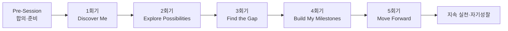

# Dream Milestone Program Guide
## 대학생·대학원생 맞춤형 5회기 다회기 커리어 코칭 프로그램

> **목적**: 학생이 자신의 경험에서 강점과 가치를 발견하고, 가능성을 탐색하며, 현실적인 이정표와 실행계획을 스스로 설계하도록 돕습니다. 이 문서는 정답을 대신 제시하는 대본이 아니라, 코치의 전문적 판단을 돕는 운영 가이드입니다.

---

# 탭 1. 개요 (Program Overview)

## 1. 프로그램 정의

Dream Milestone Program은 **대학생·대학원생을 위한 5회기 다회기 커리어 코칭 프로그램**입니다. 전공, 취업, 대학원, 직무 탐색, 진로 전환 등 불확실한 선택의 시기에 학생이 자신의 언어로 방향을 세우고 실제 경험을 통해 가설을 검증하도록 지원합니다.

이 프로그램에서 코치는 학생의 진로를 결정하거나 취업 전략을 일방적으로 처방하지 않습니다. 학생이 자신의 경험·강점·가치·관심·제약조건을 연결하고, 선택 가능한 미래를 넓힌 뒤, 작은 행동으로 다음 장면을 확인하도록 파트너링합니다.

## 2. 대상과 권장 운영 사양

| 구분 | 권장 기준 |
|---|---|
| 대상 | 대학생, 대학원생, 졸업예정자 및 초기 취업준비생 |
| 운영 형태 | 기본 1:1, 필요 시 소그룹 보조 운영 가능 |
| 회기 | 프리세션 + 본 세션 5회기 |
| 회기 시간 | 회기당 60분 내외 (프리세션 Welcome Call 15분) |
| 회기 간격 | 1~2주 권장 |
| 회기 사이 | 30~90분 수준의 Action Experiment 및 성찰 기록 |
| 기록 원칙 | 학생 성찰지와 코치 코칭일지를 분리 보관하고, 개인정보는 최소 기록 |

## 3. 4대 운영 원칙

| 원칙 | 운영 의미 | 코치의 실제 행동 |
|---|---|---|
| **Coaching First** | 학생 스스로 답과 가능성을 발견하도록 파트너링합니다. | 조언보다 경청·질문·반영을 우선하고, 학생이 목표와 행동을 선택하게 합니다. |
| **Experience on Demand** | 학생의 요청 또는 명시적 동의가 있을 때 코치의 실무 경험·정보를 보조적으로 제공합니다. | “제 경험을 짧게 공유해도 괜찮을까요?”라고 묻고, 공유 후 선택권을 학생에게 돌려줍니다. |
| **Action & Reflection** | 세션 내 대화와 세션 간 실제 행동·성찰을 순환시킵니다. | 행동을 작고 검증 가능하게 설계하고, 실행·미실행 모두에서 배움을 찾습니다. |
| **Guide, not Script** | 경직된 스크립트가 아니라 전문적 판단을 지원하는 가이드입니다. | 학생의 속도·정서·의제를 우선하며 질문, 순서, 도구를 유연하게 조정합니다. |

## 4. 5회기 표준 운영 모델 매트릭스

| 회기 | 주요 초점 (Theme) | 핵심 질문 | 학생 산출물 (Deliverables) |
|---|---|---|---|
| **1회기** | **Discover Me: 경험·강점·가치·관심 탐색** | “나는 어떤 순간에 살아 있음을 느끼고, 무엇을 중요하게 여기는가?” | **My Strength & Value Map** |
| **2회기** | **Explore Possibilities: 관심 분야·직무·가능성 확장** | “나의 강점과 가치가 살아날 수 있는 가능성은 무엇인가?” | **Career Possibility Map** |
| **3회기** | **Find the Gap: 현재와 목표 사이 Gap 탐색** | “원하는 미래와 현재 사이에서 무엇을 더 알아보고, 갖추고, 경험해야 하는가?” | **Current-Future Gap Map** |
| **4회기** | **Build My Milestones: 단계별 커리어 이정표 설계** | “내가 다음 장면으로 가기 위해 밟을 현실적 이정표는 무엇인가?” | **Career Milestone** |
| **5회기** | **Move Forward: 실행계획 및 지속 실천 약속** | “코칭이 끝난 뒤에도 나는 어떤 방식으로 나의 길을 계속 만들 것인가?” | **Action Plan + My Dream Milestone Career Map** |

## 5. 프로그램 여정

각 회기 사이에는 학생이 선택한 **Action Experiment**가 있습니다. 이는 숙제나 평가가 아니라, 생각만으로는 알 수 없는 진로 가설을 작은 경험으로 확인하는 탐색 장치입니다.

## 6. 기대 성과 및 성과평가 체계

| 대상 | 평가 영역 | 확인 지표·질문 |
|---|---|---|
| 학생 | 코칭 만족도 | “나에게 의미 있고 도움이 된 시간이었다.” |
| 학생 | 자기이해 증진 | 강점·가치·관심·제약조건을 자신의 언어로 설명할 수 있다. |
| 학생 | 커리어 명료화 | 탐색할 분야, 다음 행동, 판단 기준이 전보다 선명해졌다. |
| 학생 | 실제 Action 경험 | 회기 사이 선택한 실험을 실행·기록·성찰했다. |
| 학생 | 지속 도움도 | 종료 후에도 행동과 성찰을 이어갈 자신감·도움 정도를 느낀다. |
| 코치 | 프로그램 전반 만족도 | 운영 구조와 자료가 코칭에 실질적으로 도움이 되었다. |
| 코치 | 코칭 자신감 | 학생 주도성을 지키며 질문·경청·행동 설계를 수행할 자신감이 높아졌다. |
| 코치 | 재참여·추천 의향 | 다음 기수 참여 또는 동료 추천 의향이 있다. |

### 평가 운영 원칙

- 시작 전 간단한 사전 자기평가와 5회기 종료 후 동일 항목의 사후평가를 실시합니다.
- 점수만으로 효과를 단정하지 않고, 산출물의 변화와 학생의 서술형 성찰을 함께 봅니다.
- 평가는 학생을 선별하거나 등급화하기 위한 것이 아니라 프로그램 개선과 다음 행동 지원을 위한 것입니다.

---

# 탭 2. 코칭모델 (Coaching Model)

## 1. 코치의 기본 자세

1. 학생은 자신의 삶과 선택에 관한 가장 중요한 맥락을 알고 있습니다.
2. 코치는 학생의 답을 대신 만들지 않고, 학생이 자신의 답을 발견하도록 돕습니다.
3. 조언과 정보 제공은 학생이 요청하거나 명시적으로 동의할 때만, 짧고 선택 가능하게 제공합니다.
4. 행동의 결과는 성공·실패가 아니라 다음 선택을 위한 데이터입니다.
5. 불안, 침묵, 미실행을 결함으로 판단하지 않습니다. 그 안에서 필요한 안전·자원·현실 조건을 탐색합니다.

## 2. 회기 공통 5단계 인터랙티브 운영 프레임

| 단계 | 권장 시간 | 목적 | 핵심 코칭 질문 | 공감 표현 가이드 | 코치 체크포인트 |
|---|---:|---|---|---|---|
| **도입** | 5~10분 | 연결·현재 상태·오늘의 의제 합의 | “오늘 어떤 마음으로 오셨나요?” “끝날 때 무엇이 남으면 좋을까요?” | “그 마음으로 이 자리에 오신 것이 느껴집니다.” | 학생이 오늘의 초점을 직접 정했는가? |
| **탐색** | 15~20분 | 경험, 사실, 감정, 가치, 강점, 관심을 충분히 듣기 | “그때 실제로 어떤 일이 있었나요?” “무엇이 특히 중요했나요?” | “그 장면에서 ___가 크게 다가왔군요.” | 코치의 해석보다 학생의 언어가 중심인가? |
| **심화** | 15~20분 | 반복 패턴·의미·가정·선택 기준을 자각 | “지금 새롭게 보이는 것은 무엇인가요?” “그 선택이 당신에게 말해주는 가치는?” | “조금 천천히 그 의미를 함께 살펴봐도 될까요?” | 통찰을 코치가 결론 내리지 않았는가? |
| **실행설계** | 10~15분 | 작고 구체적인 Action Experiment 설계 | “다음 회기 전 실제로 확인해볼 한 가지는?” “언제·어디서·누구와 할까요?” | “완벽한 계획보다, 해보며 배우는 실험이면 충분합니다.” | 행동이 학생 소유이며 현실적으로 작은가? |
| **마무리** | 5분 | 핵심 통찰·행동·지원 방식 확인 | “오늘 가져갈 한 문장은?” “실행을 돕기 위해 무엇이 필요할까요?” | “오늘 발견한 것을 다음 장면으로 이어가 보시죠.” | 산출물, 행동, 기록 방법이 명료한가? |

## 3. 프리세션 (Pre-Session)

### 3.1 목적

첫 만남 전의 긴장을 낮추고, 프로그램의 성격·역할·비밀보장·운영 방식에 합의하며, 1회기에 가져올 탐색 재료를 준비합니다. 프리세션은 진로 상담이나 사전 진단이 아니라 **관계와 합의를 만드는 짧은 출발점**입니다.

### 3.2 1회기 준비 가이드

학생에게 1회기 전 다음 항목을 가볍게 기록하도록 안내합니다.

- 최근 2~3년 동안 기억에 남는 경험 3가지
- 해보며 에너지가 올라가거나 시간을 잊었던 경험 1가지
- 현재 진로와 관련해 가장 궁금하거나 막막한 질문 1가지
- 코치에게 바라는 대화 방식 또는 피하고 싶은 방식

### 3.3 학생 사전 질문지 검토 요령

| 검토할 내용 | 코치의 해석 원칙 | 1회기 활용 방식 |
|---|---|---|
| 반복되는 단어 | 성격·직무 적합성으로 단정하지 않습니다. | 학생의 표현을 그대로 되돌려 탐색합니다. |
| 경험의 전환점 | 사건의 크기보다 학생이 부여한 의미를 봅니다. | “그 경험이 지금의 당신에게 남긴 것은 무엇인가요?” |
| 불안·미루기 | 문제 행동으로 규정하지 않습니다. | 부담, 기대, 자원, 환경 조건을 확인합니다. |
| 직무·기업 언급 | 특정 목표로 고정하지 않습니다. | 관심의 이유와 다른 가능성을 함께 탐색합니다. |

### 3.4 15분 Welcome Call 지침

| 시간 | 진행 내용 | 예시 문장 |
|---:|---|---|
| 0~3분 | 환영 및 목적 안내 | “이 시간은 서로의 역할과 진행 방식을 맞추는 짧은 만남입니다.” |
| 3~7분 | 코칭·멘토링 경계와 비밀보장 합의 | “제가 경험을 나누는 경우에도 결정은 언제나 본인이 합니다.” |
| 7~11분 | 프로그램 기대와 현재 관심 확인 | “5회기를 마칠 때 무엇이 조금 더 선명해지면 좋을까요?” |
| 11~15분 | 1회기 준비와 일정 확인 | “기억에 남는 경험 세 가지만 편하게 떠올려 와 주세요.” |

---

## 4. 1회기 — Discover Me

**목표**: 경험 속에서 강점·가치·관심의 단서를 발견하고, 학생의 현재 커리어 질문을 명료화합니다. 1회기는 완성된 적성을 찾는 시간이 아니라, 학생 고유의 패턴을 발견하는 시간입니다.

| 단계 | 운영 포인트 | 핵심 질문 | 산출물 연결 |
|---|---|---|---|
| 도입 | 프리세션 내용 확인, 오늘의 기대 합의 | “오늘 어떤 경험을 이해해보고 싶나요?” | 탐색 초점 |
| 탐색 | 기억에 남는 경험 2~3개를 장면 중심으로 경청 | “그때 무엇을 했고, 무엇이 즐거웠나요?” | 경험 단서 |
| 심화 | 행동·관계·환경·감정·의미의 공통 패턴 찾기 | “반복되는 당신다운 방식은 무엇인가요?” | 강점·가치·관심 |
| 실행설계 | 일상에서 강점·에너지 순간을 관찰하는 실험 설계 | “이번 주 어떤 순간을 기록해볼까요?” | 관찰 계획 |
| 마무리 | 오늘의 자기이해를 학생 언어로 정리 | “내가 나에게 새롭게 알게 된 것은?” | **My Strength & Value Map** |

### My Strength & Value Map 양식

| 기억에 남는 경험 | 내가 한 행동 | 에너지가 난 순간 | 드러난 강점 | 중요하게 여긴 가치 | 더 탐색할 관심 |
|---|---|---|---|---|---|
|  |  |  |  |  |  |

### Between Session 1 — 나의 에너지·강점 관찰

- 1주일 동안 에너지가 높거나 낮았던 순간을 3회 이상 짧게 기록합니다.
- 각 기록에 “무엇을 했나 / 누구와 있었나 / 무엇이 중요했나 / 다음에도 해보고 싶은가”를 적습니다.
- 목표는 잘한 일을 증명하는 것이 아니라 **나에게 맞는 조건을 발견하는 것**입니다.

### [코칭일지 작성하기] — 1회기

| 기록 항목 | 코치 메모 |
|---|---|
| 학생이 가져온 의제와 기대 결과 |  |
| 반복된 단어·중요한 경험 장면 |  |
| 학생이 발견한 강점·가치·관심 |  |
| 코치가 사용한 경청·질문·반영 |  |
| 합의한 Action Experiment |  |
| 다음 회기에서 이어갈 질문 |  |
| 코치 자기성찰: 조언 욕구·가정·놓친 신호 |  |

---

## 5. 2회기 — Explore Possibilities

**목표**: 1회기의 자기이해 단서를 관심 분야·직무·환경·역할의 여러 가능성과 연결합니다. 한 가지 정답을 고르는 대신, 탐색할 만한 가능성의 지도를 넓힙니다.

| 단계 | 운영 포인트 | 핵심 질문 | 산출물 연결 |
|---|---|---|---|
| 도입 | 관찰 실험의 실행·배움 확인 | “기록에서 눈에 들어온 장면은 무엇인가요?” | 자기이해 업데이트 |
| 탐색 | 관심 분야·문제·사람·환경·역할을 폭넓게 탐색 | “어떤 문제를 다룰 때 의미를 느끼나요?” | 가능성 후보 |
| 심화 | 각 가능성의 매력과 우려, 확인이 필요한 가설을 구분 | “끌리는 이유와 아직 모르는 것은 무엇인가요?” | 탐색 가설 |
| 실행설계 | 인터뷰, 직무자료 탐색, 수업·프로젝트 등 경험 실험 선택 | “생각이 아닌 경험으로 확인할 수 있는 것은?” | 정보·경험 탐색 |
| 마무리 | 우선 탐색할 2~3개 가능성을 정리 | “지금 더 알아보고 싶은 문은 어디인가요?” | **Career Possibility Map** |

### Career Possibility Map 양식

| 가능성(분야·직무·환경) | 끌리는 이유 | 연결되는 강점·가치 | 알고 있는 사실 | 확인할 가설 | 다음 탐색 행동 |
|---|---|---|---|---|---|
|  |  |  |  |  |  |

### Between Session 2 — 가능성 검증 실험

다음 중 학생이 선택한 1~2개를 실행합니다.

- 관심 직무의 현직자 인터뷰 또는 선배 대화 1회
- 채용공고·직무기술서 3건을 읽고 공통 역량 정리
- 관련 수업, 프로젝트, 동아리, 공모전의 작은 역할 체험
- 산업 기사·기업 보고서·직무 콘텐츠를 읽고 “흥미 / 의문 / 다음 질문” 기록

### [코칭일지 작성하기] — 2회기

| 기록 항목 | 코치 메모 |
|---|---|
| Action Experiment 회고에서 드러난 배움 |  |
| 학생이 넓힌 가능성 |  |
| 가능성별 매력·우려·가설 |  |
| 정보 제공 또는 경험 공유 여부와 학생 동의 |  |
| 다음 탐색 행동 |  |
| 코치 자기성찰 |  |

---

## 6. 3회기 — Find the Gap

**목표**: 관심 있는 미래와 현재를 비교하되, 부족함을 판정하지 않고 앞으로 탐색·경험·성장할 지점을 구체화합니다. Gap은 결함 목록이 아니라 **다음 단계의 학습 지도**입니다.

| 단계 | 운영 포인트 | 핵심 질문 | 산출물 연결 |
|---|---|---|---|
| 도입 | 가능성 검증 경험에서 바뀐 생각 확인 | “직접 알아본 뒤 무엇이 더 선명해졌나요?” | 목표 가설 |
| 탐색 | 현재 자원, 경험, 역량, 관계, 환경 조건을 함께 점검 | “이미 가진 자원은 무엇인가요?” | Current 자원 |
| 심화 | 미래에 필요한 요소를 역량·경험·정보·관계·제약으로 구분 | “지금 가장 먼저 확인하거나 쌓을 것은?” | Gap 우선순위 |
| 실행설계 | 1개의 핵심 Gap을 줄이는 작은 실험 설계 | “2주 안에 증거를 하나 만들려면?” | 우선 행동 |
| 마무리 | 현재와 미래 사이의 연결점을 정리 | “이 Gap이 당신에게 요구하는 첫 걸음은?” | **Current-Future Gap Map** |

### Current-Future Gap Map 양식

| 목표 장면 | 현재 가진 자원·경험 | 더 확인·개발할 Gap | 우선순위 이유 | 활용 가능한 지원 자원 | 다음 실험 |
|---|---|---|---|---|---|
|  |  |  |  |  |  |

### Between Session 3 — Gap 줄이기 실험

- 핵심 역량의 작은 결과물 1개 만들기(포트폴리오 한 장, 분석 메모, 프로젝트 일부 등)
- 관심 분야의 실제 과업을 60~90분 체험하고 느낀 점 기록하기
- 지원자원 1명에게 구체적 피드백을 요청하기
- 제약조건이 있다면 해결이 아니라 “영향 범위와 대안”을 목록화하기

### [코칭일지 작성하기] — 3회기

| 기록 항목 | 코치 메모 |
|---|---|
| 목표 장면과 그 의미 |  |
| 현재 자원으로 확인된 강점 |  |
| 우선 Gap과 학생이 정한 이유 |  |
| 현실 제약 및 지원 자원 |  |
| Action Experiment의 성공 기준·학습 기준 |  |
| 코치 자기성찰 |  |

---

## 7. 4회기 — Build My Milestones

**목표**: 발견한 방향과 Gap을 바탕으로 단기·중기·장기 이정표를 설계합니다. 이정표는 고정된 인생 계획이 아니라, 학생이 현실을 보며 조정할 수 있는 **살아 있는 경로**입니다.

| 단계 | 운영 포인트 | 핵심 질문 | 산출물 연결 |
|---|---|---|---|
| 도입 | Gap 실험의 결과와 배움 회고 | “해보니 예상과 달랐던 것은 무엇인가요?” | 경로 조정 |
| 탐색 | 6개월~3년의 원하는 장면과 전환점을 그리기 | “그 장면에 도착하기 전 어떤 경험이 필요할까요?” | 이정표 후보 |
| 심화 | 의존관계·우선순위·대안 경로·위험 요인 점검 | “이 단계가 막히면 어떤 다른 길이 있나요?” | 유연한 경로 |
| 실행설계 | 첫 번째 이정표의 착수 행동과 점검 시점 설정 | “다음 2주에 표시할 첫 발자국은?” | 시작 행동 |
| 마무리 | 학생이 납득하는 경로를 한 문장으로 정리 | “이 경로가 당신다운 이유는?” | **Career Milestone** |

### Career Milestone 양식

| 시점 | 이루고 싶은 장면 | 필요한 경험·역량 | 확인 지표 | 도움 받을 자원 | 대안 경로 |
|---|---|---|---|---|---|
| 0~3개월 |  |  |  |  |  |
| 3~12개월 |  |  |  |  |  |
| 1~3년 |  |  |  |  |  |

### Between Session 4 — 이정표 착수와 조정

- 첫 이정표의 시작 행동을 실제 일정에 넣고 실행합니다.
- 실행한 뒤 “무엇을 했나 / 무엇이 작동했나 / 무엇이 막혔나 / 다음에는 무엇을 조정할까”를 기록합니다.
- 5회기에 가져갈 최종 Career Map 초안을 만듭니다.

### [코칭일지 작성하기] — 4회기

| 기록 항목 | 코치 메모 |
|---|---|
| 이정표 설계 전 학생의 현재 인식 |  |
| 학생이 선택한 핵심 경로와 대안 |  |
| 현실성·유연성 점검에서 나온 내용 |  |
| 첫 이정표 행동과 점검 날짜 |  |
| 5회기 종결을 위해 준비할 사항 |  |
| 코치 자기성찰 |  |

---

## 8. 5회기 — Move Forward & Completion

**목표**: 전체 여정을 성찰하고, 최종 Career Map과 지속 실행 구조를 완성합니다. 종결은 관계의 단절이 아니라 학생이 자기 질문과 자기조정의 힘을 갖고 떠나는 전환점입니다.

| 단계 | 운영 포인트 | 핵심 질문 | 산출물 연결 |
|---|---|---|---|
| 도입 | 마지막 실험과 현재 상태 확인 | “처음 만났을 때와 비교해 무엇이 달라졌나요?” | 변화 인식 |
| 탐색 | 1~4회기의 산출물과 주요 장면을 함께 회고 | “가장 의미 있었던 발견은 무엇인가요?” | 성장 서사 |
| 심화 | 자기이해·가능성·Gap·이정표의 연결 확인 | “당신의 지도에서 변하지 않을 기준은?” | 나만의 기준 |
| 실행설계 | 30·60·90일 행동계획, 점검 리듬, 지원망 설정 | “혼자 막힐 때 무엇을 묻고 누구에게 연결할까요?” | 지속 시스템 |
| 마무리 | 코칭 종결 합의와 서로의 배움 정리 | “미래의 나에게 남기고 싶은 약속은?” | **Action Plan + My Dream Milestone Career Map** |

### My Dream Milestone Career Map 구성

1. 나의 핵심 강점·가치·관심
2. 탐색할 가능성 2~3개와 그 이유
3. 현재 자원과 우선 Gap
4. 0~3개월 / 3~12개월 / 1~3년 이정표
5. 30·60·90일 Action Plan
6. 막힐 때의 자기질문과 도움 요청 경로

### 30·60·90일 Action Plan 양식

| 시점 | 꼭 해볼 행동 | 완료·학습 기준 | 예상 장애물 | 조정 방법 | 점검 파트너 |
|---|---|---|---|---|---|
| 30일 |  |  |  |  |  |
| 60일 |  |  |  |  |  |
| 90일 |  |  |  |  |  |

### [코치 성과평가]

아래 문항은 5점 척도와 서술형을 함께 사용합니다.

| 평가 영역 | 평가 문항 |
|---|---|
| 프로그램 운영 | 5회기 구조와 운영 자료가 학생의 탐색과 실행을 돕는 데 적절했다. |
| 코칭 자신감 | 학생 주도성을 지키면서 경청·질문·행동 설계를 수행할 자신감이 높아졌다. |
| Experience on Demand | 경험·정보를 필요할 때만, 선택권을 보장하며 제공했다. |
| 실행 지원 | 학생의 Action Experiment를 평가가 아닌 학습으로 다루었다. |
| 재참여 의향 | 다음 프로그램에도 코치로 참여할 의향이 있다. |
| 추천 의향 | 동료 코치에게 이 프로그램을 추천할 의향이 있다. |

**서술형 질문**

- 가장 효과적이었던 운영 요소는 무엇이었습니까?
- 다음 기수에서 개선할 운영 요소는 무엇입니까?
- 코치로서 새롭게 발견한 강점 또는 학습은 무엇입니까?

### [학생 성과평가]

아래 문항은 사전·사후 비교가 가능하도록 동일 문항을 사용합니다.

| 평가 영역 | 학생 자기평가 문항 |
|---|---|
| 코칭 만족도 | 이 프로그램은 나에게 의미 있고 도움이 되었다. |
| 자기이해 | 나는 나의 강점·가치·관심을 전보다 더 잘 설명할 수 있다. |
| 커리어 명료화 | 내가 더 탐색하거나 시도할 커리어 방향이 전보다 선명해졌다. |
| 행동 경험 | 나는 실제 행동을 통해 내 진로 가설을 확인해 보았다. |
| 자기효능감 | 막히는 상황에서도 작게 시작하고 조정할 수 있다는 자신감이 있다. |
| 지속 도움도 | 코칭 종료 후에도 나의 계획을 점검하고 행동을 이어갈 수 있을 것 같다. |

**서술형 질문**

- 가장 크게 발견한 나의 모습 또는 가능성은 무엇입니까?
- 실제로 해본 행동과 그 행동이 알려준 것은 무엇입니까?
- 앞으로 30일 안에 지키고 싶은 약속은 무엇입니까?
- 프로그램에서 보완되면 좋을 점은 무엇입니까?

---

# 탭 3. 운영 도구 (Operations Toolkit)

## 1. Experience on Demand 프로토콜

코치가 경험·정보를 제공할 필요가 있을 때에는 다음 순서를 지킵니다.

1. **필요 확인**: “지금은 질문으로 더 탐색하는 것과, 제 경험을 짧게 듣는 것 중 무엇이 도움이 될까요?”
2. **동의 획득**: “제 경험을 2분 정도 공유해도 괜찮을까요?”
3. **제한적 공유**: 사실과 맥락을 짧게 공유하고 일반화하지 않습니다.
4. **선택권 반환**: “이 이야기가 당신의 상황에는 어떻게 닿나요? 가져갈 부분과 아닌 부분은 무엇인가요?”

## 2. Action Experiment 설계 카드

| 항목 | 작성 내용 |
|---|---|
| 확인하고 싶은 가설 |  |
| 이번에 해볼 가장 작은 행동 |  |
| 실행 일시·장소·협력자 |  |
| 완료 기준 |  |
| 결과와 무관하게 얻고 싶은 배움 |  |
| 예상 장애물과 더 작은 대안 |  |

## 3. 윤리·안전·기록 원칙

- 비밀보장의 범위와 예외(자·타해 위험, 법적·기관 절차상 필요한 경우)를 시작 전에 명확히 안내합니다.
- 심각한 정서 위기, 안전 위험, 치료·상담이 필요한 상황은 코칭 범위를 넘어설 수 있음을 알리고 기관의 보호·연계 절차를 우선합니다.
- 기록에는 판단적 표현이나 불필요한 개인식별정보를 남기지 않습니다.
- 학생의 산출물은 학생의 소유이며, 프로그램 개선에 활용할 때는 별도 동의를 받습니다.

## 4. 품질 점검 체크리스트

| 점검 항목 | 예 | 아니오 | 메모 |
|---|:---:|:---:|---|
| 학생이 매 회기 의제와 기대 결과를 직접 정했다. |  |  |  |
| 코치는 학생의 언어와 경험을 충분히 경청했다. |  |  |  |
| 경험·정보 제공 전 학생의 요청 또는 동의를 확인했다. |  |  |  |
| Action Experiment가 작고 구체적이며 학생 소유였다. |  |  |  |
| 미실행을 평가하지 않고 배움으로 다루었다. |  |  |  |
| 학생이 자신의 Career Map을 직접 완성했다. |  |  |  |

---

# 최종 운영 원칙

좋은 커리어 코칭은 학생에게 하나의 답을 주는 일이 아닙니다. 학생이 자신의 경험에서 방향을 읽고, 아직 보이지 않는 길을 작은 행동으로 비추며, 다음 선택을 스스로 조정할 수 있게 만드는 일입니다.

**Dream Milestone Program은 학생이 ‘정답을 찾는 사람’에서 ‘자신의 길을 설계하고 검증하는 사람’으로 이동하도록 돕습니다.**
