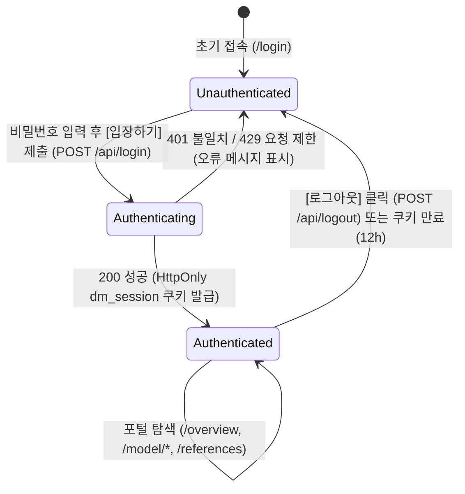

# 02. 제품 및 기능 명세서 (PRD / Functional Specification)

- **문서 ID**: `DOC-DM-02`
- **버전 (Version)**: `v1.0.0`
- **상태 (Status)**: `Approved Baseline`
- **작성일**: `2026-11-22`
- **오너 (Owner)**: `삼성코칭동호회(SCC) 운영진`
- **상위 인덱스**: [00.index.md](./00.index.md) · **요구사항 기준**: [01.SRS.md](./01.SRS.md)

---

## 1. 기능 매핑 총괄표 (`FN-*` ↔ `FR-*` ↔ `SCR-*`)

| 기능 ID | 기능명 | 연결 요구사항 (`FR-*`) | 연결 화면 (`SCR-*`) | 연결 API / 엔티티 | 연결 테스트 (`TC-*`) |
| :--- | :--- | :--- | :--- | :--- | :--- |
| `FN-001` | 랜딩 & 코치 공용 비밀번호 로그인/로그아웃 및 라우트 보호 | `FR-001`, `FR-002` | `SCR-001`~`SCR-006` | `API-001`, `API-002`, `API-003`, `ENT-001` | `TC-001`~`TC-004` |
| `FN-002` | 반응형 앱 셸 & 3대 기능 탭 사이드바 내비게이션 | `FR-003` | `SCR-002`~`SCR-006` | `ENT-002`, `ENT-003` | `TC-005` |
| `FN-003` | 라이트/다크 듀얼 테마 전환기 | `FR-003` | `SCR-001`~`SCR-006` | - | `TC-006`, `TC-014` |
| `FN-004` | 탭 1: 프로그램 개요·4대 원칙·SHARE·윤리 뷰어 | `FR-004` | `SCR-002` | `ENT-002` | `TC-007` |
| `FN-005` | 탭 2: 프리세션 질문지 검토 기준 및 Welcome Call 뷰어 | `FR-005` | `SCR-003` | `ENT-003` | `TC-008` |
| `FN-006` | 탭 2: 1~5회기 5단계 인터랙티브 탭·산출물·Between 실험 뷰어 | `FR-006` | `SCR-004`, `SCR-005` | `ENT-003` | `TC-009`, `TC-010` |
| `FN-007` | 회기별 코치 체크포인트 로컬 상태 저장 및 초기화 | `FR-007` | `SCR-004`, `SCR-005`, `SCR-006` | `ENT-004` | `TC-011` |
| `FN-008` | 1~4회기 코칭일지 & 5회기 성과평가 구글폼 연동 및 링크 복사 | `FR-008`, `FR-009` | `SCR-004`, `SCR-005` | `ENT-005` | `TC-012`, `TC-013` |
| `FN-009` | 탭 3: 참조자료 다운로드 허브(5종)·코칭 도구 맵·자가점검표 | `FR-010` | `SCR-006` | `ENT-005`, `ENT-004` | `TC-015`, `TC-016` |

---

## 2. 핵심 사용자 플로우 및 상태 머신

### 2.1 인증 및 세션 상태 머신 (`FN-001`)

**텍스트 폴백 (Textual Fallback)**:
1. `Unauthenticated` 상태에서 사용자가 `/login`에 접속하여 공용 비밀번호를 입력하고 제출하면 `Authenticating` 상태로 전이한다.
2. `POST /api/login` 검증 성공 시 `dm_session` 쿠키를 발급받아 `Authenticated` 상태로 전이하고 `/overview`(또는 `next` 파라미터 경로)로 이동한다.
3. 비밀번호 불일치(401) 또는 연속 실패 제한(429) 시 `Unauthenticated` 상태를 유지하며 인라인 오류 메시지를 표시한다.
4. `Authenticated` 상태에서 로그아웃(`POST /api/logout`)하거나 12시간 만료 시 쿠키를 폐기하고 `Unauthenticated`(`SCR-001`)로 복귀한다.

### 2.2 코치의 5회기 코칭 수행 플로우 (`FN-004` ~ `FN-009`)
1. **사전 준비**: 코치가 `/login`에서 입장 → `탭 1: 개요`(`SCR-002`)에서 4대 원칙·SHARE 프로토콜 확인 → `탭 3: 참조자료`(`SCR-006`)에서 `사전 준비지` 및 `Full Guide.pdf` 확인.
2. **프리세션 수행**: `탭 2: 코칭모델 > 프리세션`(`SCR-003`)에서 학생 사전 질문지 검토 기준 확인 후 15분 Welcome Call 타임라인 스크립트에 따라 오리엔테이션 진행.
3. **1~4회기 본 세션 및 일지 기록**: `탭 2: 코칭모델 > 1회기~4회기`(`SCR-004`)에서 `도입(10분) → 탐색(15분) → 심화(15분) → 실행설계(12분) → 마무리(8분)` 탭을 전환하며 질문·공감 가이드를 참조하고 체크포인트(`☐`)를 체크(`FN-007`). 세션 종료 후 `Between Session` 탭에서 실험 과제를 안내하고 `[N회기 코칭일지 작성하기 ↗]`(`FN-008`)로 구글폼 일지를 제출.
4. **5회기 종결 및 성과평가**: `탭 2: 코칭모델 > 5회기`(`SCR-005`)에서 최종 `My Dream Milestone Career Map`과 `30·60·90일 Action Plan` 통합을 지원한 뒤, `[학생 성과평가 링크 복사]`로 학생에게 평가 링크를 전달하고 코치 본인은 `[코치 성과평가 작성하기 ↗]`를 제출(`FN-008`).

---

## 3. 기능별 상세 명세

### 3.1 `FN-001`: 랜딩 & 코치 공용 비밀번호 로그인/로그아웃 및 라우트 보호
- **연결 요구사항**: `FR-001`, `FR-002`, `RULE-001`, `RULE-007`, `NFR-004`
- **입력 (Inputs)**:
  - `password` (string, 필수, 앞뒤 공백 제거 전 원본 비교, 최대 128자)
  - `next` (string, 선택, 내부 상대 경로 `/overview`, `/model/*`, `/references`만 허용, 오픈 리다이렉트 방지)
- **처리 로직 (Ordered Logic)**:
  1. 클라이언트 폼 제출 시 빈 값 여부를 검사하고 버튼 상태를 `입장 확인 중...`(`disabled`)으로 전환한다.
  2. `POST /api/login`에서 서버 환경변수 `COACH_SHARED_PASSWORD`와 상수 시간 비교(`crypto.timingSafeEqual`)를 수행한다.
  3. 일치 시 만료 시각(`exp = now + 12h`)과 HMAC-SHA256 서명을 포함한 `dm_session` 쿠키(`HttpOnly; Secure; SameSite=Lax; Path=/`)를 설정하고 `{ ok: true, redirectTo }`를 반환한다.
  4. 불일치 시 HTTP 401과 `{ ok: false, message: "비밀번호가 일치하지 않습니다. 삼성코칭동호회(SCC) 운영진에게 문의해 주세요." }`를 반환한다.
  5. `middleware.ts`는 보호 경로 요청 시 `dm_session` 서명과 만료 시각을 검증하여 미인증 요청을 `/login?next=<pathname>`으로 리다이렉트한다.
- **출력 및 상태**: 성공 시 `/overview` 이동; 실패 시 `role="alert"` 오류 배너 표시; 로그아웃 시 쿠키 즉시 삭제 및 `/login` 이동.
- **권한**: 비인증 사용자(`POST /api/login`), 인증 코치(`POST /api/logout`).
- **완료 기준**: `TC-001`, `TC-002`, `TC-003`, `TC-004` 통과.

### 3.2 `FN-002`: 반응형 앱 셸 & 3대 기능 탭 사이드바 내비게이션
- **연결 요구사항**: `FR-003`, `NFR-003`
- **입력**: 사용자의 사이드바 메뉴 클릭, 데스크톱/모바일 사이드바 접기/펼치기 토글 버튼 클릭, 모바일 햄버거 메뉴 토글, 상단바 `자료 다운로드` 바로가기 클릭.
- **처리 로직**:
  1. 좌측 사이드바를 3대 최상위 그룹으로 렌더링한다:
     - **개요** (`/overview`)
     - **코칭모델** (하위 메뉴: `프리세션` `/model/pre`, `1회기 Discover Me` `/model/session-1`, `2회기 Explore Possibilities` `/model/session-2`, `3회기 Find the Gap` `/model/session-3`, `4회기 Build My Milestones` `/model/session-4`, `5회기 Move Forward` `/model/session-5`)
     - **참조자료** (`/references`)
  2. 메뉴 항목은 3D 음각 스타일(`nav-debossed`)을 적용하며, 현재 활성 경로에는 입체적 활성 스타일(`nav-debossed-active`, `aria-current="page"`)을 부여한다.
  3. 사이드바 상단에 데스크톱 및 모바일 공용 접기/펼치기 토글 버튼을 제공하여 세션 진행 시 넓은 작업 공간을 확보할 수 있도록 한다.
  4. 모바일 및 갤럭시 폴드 전면 커버화면 등 좁은 뷰포트(`< 640px`)에서는 상단바 메뉴 텍스트를 숨기고 아이콘 단독(`🌙`/`☀️`, `🚪`)으로 전환하여 헤더 넘침을 방지한다.
  5. 모바일 드로어(`< 1024px`)에서 메뉴 항목 선택 또는 `Escape` 키 입력 시 드로어를 자동으로 닫고 포커스를 복원한다.
- **완료 기준**: `TC-005` 통과.

### 3.3 `FN-003`: 라이트/다크 듀얼 테마 전환기
- **연결 요구사항**: `FR-003`, `RULE-006`, `NFR-002`
- **입력**: 상단바(및 `/login` 헤더)의 테마 토글 버튼 클릭.
- **처리 로직**:
  1. 초기 로드 시 `<head>` 인라인 스크립트가 `localStorage.getItem('scd.theme')`를 확인하여 `'dark'`이면 `<html data-theme="dark">`, 아니면 `<html data-theme="light">`를 깜빡임(FOUC) 없이 설정한다.
  2. 토글 클릭 시 `light` ↔ `dark`를 전환하고 `localStorage.setItem('scd.theme', nextTheme)`에 저장한다.
- **완료 기준**: `TC-006`, `TC-014` 통과.

### 3.4 `FN-004`: 개요(Overview) — 프로그램 개요·표준 사양·5회기 3D 프로세스 카드
- **연결 요구사항**: `FR-004`, `RULE-003`, `RULE-007`, `DEC-009`
- **입력**: `/overview` 진입, 5회기 프로세스 스텝 카드 클릭.
- **처리 로직**:
  1. `Dream_Milestone_Program_Guide.md` Part 1의 표준 데이터를 렌더링한다:
     - 메인 히어로: 프로그램 핵심 비전 ("현재와 목표 사이의 Gap을 발견하고 자신만의 커리어 Milestone과 Action을 설계하도록 곁에서 돕습니다")
     - 프로그램 정의 및 표준 운영 사양 카드(삼성코칭동호회(SCC) 주관 / 대학생·대학원생, 15분 Welcome Call + 60분×5회기)
     - 5회기 표준 운영 모델 3D 프로세스 스텝 카드:
       - 프리세션(합의/사전준비) 및 1회기(Discover Me)부터 5회기(Move Forward)까지 6개 회기별 목표, 핵심 도구, 산출물, 소요 시간을 입체 카드 형태로 배치하고 클릭 시 해당 회기 가이드로 바로 이동.
  2. 불필요한 중복 표 및 반복 텍스트를 제거하고 모바일 터치 및 데스크톱 가독성에 최적화한다.
- **완료 기준**: `TC-007` 통과.

### 3.5 `FN-005`: 탭 2 — 프리세션 질문지 검토 기준 및 Welcome Call 뷰어
- **연결 요구사항**: `FR-005`
- **입력**: `/model/pre` 진입.
- **처리 로직**:
  1. 프리세션 목적 및 1회기 사전 준비 체크리스트(3항목)를 표시한다.
  2. 학생 사전 질문지 4대 항목(`현재 고민`, `기대 결과`, `경험 자산`, `대화 선호`)과 코치 검토·활용 원칙 매트릭스를 표시한다.
  3. 15분 Welcome Call 4구간 타임라인(`0~3분 환영·라포`, `3~7분 원칙·비밀보장 합의`, `7~11분 사전 질문지·기대 확인`, `11~15분 1회기 준비·일정 확정`)과 코치 예시 스크립트 카드를 표시한다.
  4. 하단에 `[1회기 Discover Me 가이드로 이동 →]` 내비게이션 버튼을 제공한다.
- **완료 기준**: `TC-008` 통과.

### 3.6 `FN-006`: 탭 2 — 1~5회기 5단계 인터랙티브 탭·산출물·Between 실험 뷰어
- **연결 요구사항**: `FR-006`, `RULE-003`, `RULE-008`
- **입력**: `/model/session-1` ~ `/model/session-5` 진입, 단계 탭(`intro`, `explore`, `deepen`, `action`, `close`, `between`) 클릭, 키보드 좌우 화살표 키 입력.
- **처리 로직**:
  1. 상단 헤더에 회기 번호 배지, 회기 테마(`Discover Me` 등), 회기 목표, 핵심 탐색 질문, 학생 산출물 명칭을 표시한다.
  2. ARIA Tabs 패턴(`role="tablist"`, `role="tab"`, `role="tabpanel"`)으로 5단계 탭(1~4회기는 6번째 `Between Session` 탭 추가)을 렌더링하고 선택된 탭을 `?stage=<stageKey>` 쿼리와 동기화한다(유효하지 않은 `stage` 파라미터 입력 시 기본값 `intro`로 폴백).
  3. 선택된 단계 패널에 **권장 소요 시간 배지**, **핵심 코칭 질문 리스트**, **공감 표현 가이드 박스**, **코치 체크포인트 체크박스(`FN-007`)**를 표시한다.
  4. 회기별 학생 산출물 템플릿 표(1회기 `My Strength & Value Map`, 2회기 `Career Possibility Map`, 3회기 `Current-Future Gap Map`, 4회기 `Career Milestone`, 5회기 `My Dream Milestone Career Map` + `30·60·90일 Action Plan`)를 제공한다.
  5. 1~4회기의 `Between Session` 탭(또는 하단 고정 카드)에 회기 간 `Action Experiment` 과제와 기록 공식을 표시한다.
- **완료 기준**: `TC-009`, `TC-010` 통과.

### 3.7 `FN-007`: 회기별 코치 체크포인트 로컬 상태 저장 및 초기화
- **연결 요구사항**: `FR-007`, `NFR-006`
- **입력**: 체크포인트 체크박스 클릭, `[이 회기 체크 초기화]` 버튼 클릭.
- **처리 로직**:
  1. 각 체크박스는 고유 ID(`s1-intro-1`, `s1-explore-1`, ..., `qa-check-1`~`qa-check-6`)를 가진다.
  2. 체크 상태 변경 시 `localStorage.setItem('dm.checklist', JSON.stringify(stateMap))`으로 저장하고 회기 상단 진행률 배지(예: `체크 완료 3 / 5`)를 즉시 갱신한다.
  3. `[이 회기 체크 초기화]` 클릭 시 현재 회기의 키만 `false`로 초기화하고 토스트(`"체크리스트가 초기화되었습니다."`)를 표시한다.
  4. `localStorage` 접근 불가(사파리 프라이빗 모드 제한 등) 시 인메모리 상태로 폴백하여 오류 없이 동작한다.
- **완료 기준**: `TC-011` 통과.

### 3.8 `FN-008`: 1~4회기 코칭일지 & 5회기 성과평가 구글폼 연동 및 학생 링크 복사
- **연결 요구사항**: `FR-008`, `FR-009`, `RULE-002`, `RULE-004`, `RULE-005`, `DEC-014`
- **입력**:
  - 1~4회기: `[N회기 코칭일지 작성하기 (구글폼) ↗]` 클릭
  - 5회기: `[코치 성과평가 작성하기 (구글폼) ↗]` 클릭, `[학생 성과평가 열기 ↗]` 클릭, `[학생 성과평가 링크 복사]` 클릭
- **처리 로직**:
  1. `src/config/external-links.ts`(`ENT-005`)에서 대상 URL을 조회한다 (기본값 완비):
     - 1~4회기 코칭일지: `https://forms.gle/t12jNnjeY22n6DkG8`
     - 5회기 코치 성과평가: `https://forms.gle/9EJBCuRyVyUYH92m7`
     - 5회기 학생 성과평가: `https://forms.gle/26QZapKELpU261XS6`
  2. 1~4회기 코칭일지 버튼은 확정된 코칭일지 구글폼 URL을 새 탭으로 연다.
  3. 5회기에서는 코치 성과평가 구글폼 CTA와 학생 성과평가 구글폼 CTA(새 탭 열기 + 클립보드 복사)를 분리된 카드로 제공한다.
  4. `[학생 성과평가 링크 복사]` 클릭 시 클립보드에 학생용 구글폼 URL을 복사하고 `"학생 성과평가 링크가 클립보드에 복사되었습니다."` 토스트를 표시한다.
- **완료 기준**: `TC-012`, `TC-013` 통과.

### 3.9 `FN-009`: 탭 3 — 참조자료 다운로드 허브(5종)·코칭 도구 맵·자가점검표
- **연결 요구사항**: `FR-010`, `RULE-005`
- **입력**: `/references` 진입, 리소스 다운로드 카드 클릭, 도구 맵 회기 필터 클릭, 품질 자가점검 체크박스 클릭.
- **처리 로직**:
  1. **공식 리소스 5종 다운로드 그리드**:
     - `RES-01`: `Dream Milestone Full Guide.pdf` (프리세션~5회기 전체 코치 가이드북 원문)
     - `RES-02`: `프리세션 사전 준비지` (학생 사전 질문지 및 1회기 경험 탐색 안내서)
     - `RES-03`: `학생용 My Dream Milestone Workbook` (1~5회기 산출물 템플릿 5종 + Action Experiment 기록지)
     - `RES-04`: `코치 사전 OT 자료 및 운영 매뉴얼` (모집·매칭·OT·코칭·평가 전체 절차 및 역할 합의서)
     - `RES-05`: `핵심 질문 라이브러리 & 커리어 가치 카드` (회기별 심화 질문 모음집 및 가치·강점 카드)
  2. **회기별 선택형 코칭 도구 활용 맵**: 1회기(`Life Curve`, `문제 외재화`, `CiT STAR™`), 2회기(`D-H-B 프레임`, `Career Decision 6축`), 3회기(`GROW Reality`, `Decision Matrix`), 4회기(`BRAVE`, `Mandarat`, `Small Win`), 5회기(`Self-Coaching 카드`, `30·60·90 플랜`) 상세 가이드를 표시한다.
  3. **Action Experiment 공통 설계 카드** (5개 설계 항목 표) 및 **코치 세션 품질 자가점검 체크리스트** (6개 체크 항목, `FN-007` 연동)를 하단에 렌더링한다.
- **완료 기준**: `TC-015`, `TC-016` 통과.

---

## 4. 역할 및 권한 매트릭스 (Role-Permission Matrix)

| 기능 / 화면 / API | 비인증 방문자 (`Unauthenticated`) | 인증된 삼코동 코치 (`ROLE-COACH`) | 삼코동 운영진 (`ROLE-ADMIN`) |
| :--- | :---: | :---: | :---: |
| `SCR-001` (`/login`) 및 `API-001` (`POST /api/login`) | 허용 | 허용 (`/overview`로 자동 이동) | 허용 |
| `SCR-002`~`SCR-006` (`/overview`, `/model/*`, `/references`) | 차단 (`/login` 리다이렉트) | 허용 (열람·체크·복사·외부 폼 이동) | 허용 |
| `API-002` (`POST /api/logout`), `API-003` (`GET /api/session`) | 제한 (`authenticated: false`) | 허용 | 허용 |
| 환경변수(`COACH_SHARED_PASSWORD`, 구글폼/드라이브 URL) 변경 | 불가 | 불가 | 허용 (Netlify 대시보드) |
