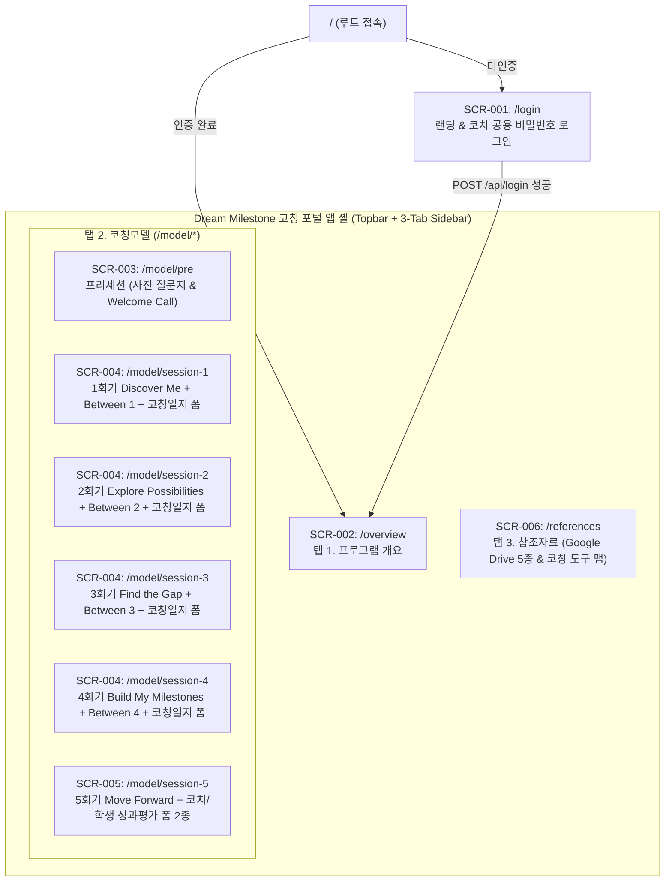

# 03. 정보 구조도 (Information Architecture)

- **문서 ID**: `DOC-DM-03`
- **버전 (Version)**: `v1.0.0`
- **상태 (Status)**: `Approved Baseline`
- **작성일**: `2026-11-22`
- **오너 (Owner)**: `삼성코칭동호회(SCC) 운영진`
- **상위 인덱스**: [00.index.md](./00.index.md) · **기능 명세**: [02.PRD-FS.md](./02.PRD-FS.md)

---

## 1. IA 설계 원칙

1. **3대 기능 탭 직관성**: 포털 진입 후 모든 콘텐츠는 좌측 사이드바의 **3대 기능 탭(`개요`, `코칭모델`, `참조자료`)** 안에서 2클릭 이내에 도달한다.
2. **시맨틱 URL 및 단계 딥링크 (`DEC-004`)**: 각 탭과 회기는 고유 URL 경로를 가지며, 회기 내부 5단계 탭과 Between Session 탭은 `?stage=` 쿼리 파라미터로 상태를 표현하여 북마크·새로고침·브라우저 히스토리를 완벽히 지원한다.
3. **Zero-DB 정적 콘텐츠 + 외부 링크 분리 (`DEC-005`)**: 가이드북 본문 데이터(`ENT-002`, `ENT-003`)는 타입 안전 정적 모듈로 번들링하고, 코칭일지·성과평가·다운로드 URL은 `ENT-005`(`src/config/external-links.ts`)로 단일화한다.

---

## 2. 사이트맵 및 애플리케이션 셸 구조

**텍스트 폴백 (Textual Fallback)**:
- `/` 접속 시 미인증 상태면 `SCR-001`(`/login`)으로, 인증 상태면 `SCR-002`(`/overview`)로 라우팅한다.
- 포털 앱 셸 내부 좌측 사이드바는 `탭 1. 개요`(`SCR-002`: `/overview`), `탭 2. 코칭모델`(`SCR-003`: `/model/pre`, `SCR-004`: `/model/session-1`~`4`, `SCR-005`: `/model/session-5`), `탭 3. 참조자료`(`SCR-006`: `/references`)로 구성된다.

---

## 3. 화면 레지스트리 (`SCR-*`)

| 화면 ID | 화면명 | URL 경로 및 쿼리 | 접근 권한 | 포함 기능 (`FN-*`) | 정보 밀도 및 레이아웃 특성 |
| :--- | :--- | :--- | :---: | :--- | :--- |
| `SCR-001` | 랜딩 및 코치 로그인 | `/login` (`?next=`) | 전체 (인증 시 `/overview` 이동) | `FN-001`, `FN-003` | 2단 히어로(좌: 삼코동 비전 소개, 우: 비밀번호 카드) + 북극성 여정 SVG + 3단계 철학 카드 |
| `SCR-002` | 탭 1: 프로그램 개요 | `/overview` | `ROLE-COACH` | `FN-002`, `FN-003`, `FN-004` | 요약 배너 + 4대 원칙 2×2 카드 + SHARE 5단계 스테퍼 + 5회기 매트릭스 표 + KPI 표 + 윤리 콜아웃 |
| `SCR-003` | 탭 2: 프리세션 가이드 | `/model/pre` | `ROLE-COACH` | `FN-002`, `FN-003`, `FN-005`, `FN-007` | 준비 체크리스트 + 사전 질문지 검토 기준표 + 15분 Welcome Call 4구간 타임라인 카드 |
| `SCR-004` | 탭 2: 1~4회기 코칭모델 상세 | `/model/session-1` ~ `/model/session-4` (`?stage=intro\|explore\|deepen\|action\|close\|between`) | `ROLE-COACH` | `FN-002`, `FN-003`, `FN-006`, `FN-007`, `FN-008` | 회기 헤더 + 6개 인터랙티브 단계 탭 + 질문/공감/체크포인트 패널 + 산출물 템플릿 표 + 코칭일지 구글폼 CTA 바 |
| `SCR-005` | 탭 2: 5회기 종결 및 성과평가 | `/model/session-5` (`?stage=intro\|explore\|deepen\|action\|close`) | `ROLE-COACH` | `FN-002`, `FN-003`, `FN-006`, `FN-007`, `FN-008` | 회기 헤더 + 5개 단계 탭 + 최종 Career Map & 30·60·90일 Action Plan 템플릿 + 코치/학생 성과평가 구글폼 2종 CTA 카드 |
| `SCR-006` | 탭 3: 참조자료 및 운영 툴킷 | `/references` | `ROLE-COACH` | `FN-002`, `FN-003`, `FN-007`, `FN-009` | Google Drive 리소스 5종 다운로드 카드 그리드 + 회기별 선택형 코칭 도구 맵 + Action Experiment 설계 카드 + 품질 자가점검표 |

---

## 4. 내비게이션 및 URL 상태 규칙

1. **사이드바 그룹 구조**:
   - `1. 개요` → `/overview` (`SCR-002`)
   - `2. 코칭모델` (아코디언 기본 펼침)
     - `PRE · 프리세션` → `/model/pre` (`SCR-003`)
     - `01 · Discover Me` → `/model/session-1` (`SCR-004`)
     - `02 · Explore Possibilities` → `/model/session-2` (`SCR-004`)
     - `03 · Find the Gap` → `/model/session-3` (`SCR-004`)
     - `04 · Build My Milestones` → `/model/session-4` (`SCR-004`)
     - `05 · Move Forward (종결)` → `/model/session-5` (`SCR-005`)
   - `3. 참조자료` → `/references` (`SCR-006`)
2. **회기 단계 쿼리 파라미터 (`?stage=`)**:
   - 허용 값: `intro`(기본값, 10분), `explore`(15분), `deepen`(15분), `action`(12분), `close`(8분), `between`(1~4회기 전용 Between Session).
   - 단계 탭 클릭 시 `router.replace(pathname + '?stage=' + stageKey, { scroll: false })`로 URL을 갱신한다.
3. **회기 간 이전/다음 이동**: 각 회기 화면 하단에 `[← 이전 회기]` 및 `[다음 회기 →]` 보조 내비게이션 링크를 제공한다.

---

## 5. 도메인 엔티티 명세 (`ENT-*`)

Zero-DB 아키텍처에 따라 서버 영속 DB 테이블을 두지 않으며, 정적 TypeScript 데이터 모델과 브라우저/쿠키 엔티티로 구성한다.

| 엔티티 ID | 엔티티명 | 저장 위치 | 민감도 | 보존 기간 | 주요 필드 구조 |
| :--- | :--- | :--- | :---: | :--- | :--- |
| `ENT-001` | `AuthSession` | `HttpOnly` 쿠키 (`dm_session`) | High (인증 토큰) | 발급 후 12시간 (또는 로그아웃 시 즉시 파기) | `role: 'COACH'`, `iat: number`, `exp: number`, `sig: string (HMAC-SHA256)` |
| `ENT-002` | `ProgramOverviewData` | 정적 번들 (`src/data/program-overview.ts`) | Public (코치 전용) | 영구 (코드 버전 관리) | `definition`, `specs[]`, `principles[4]`, `shareProtocol[5]`, `sessionMatrix[6]`, `kpis{student[5], coach[3]}`, `ethics[3]` |
| `ENT-003` | `CoachingSessionGuide` | 정적 번들 (`src/data/coaching-sessions.ts`) | Public (코치 전용) | 영구 (코드 버전 관리) | `slug`, `badge`, `title`, `theme`, `goal`, `coreQuestion`, `deliverableName`, `deliverableColumns[]`, `stages[5]`, `betweenSession?`, `formType: 'LOG'\|'EVAL'` |
| `ENT-004` | `CoachChecklistState` | 브라우저 `localStorage` (`dm.checklist`) | Low (비식별 불리언) | 브라우저 캐시 삭제 또는 초기화 버튼 클릭 시까지 | `Record<checkpointId: string, boolean>` (PII 일절 미포함) |
| `ENT-005` | `ExternalLinkConfig` | 정적 설정 + 환경변수 (`src/config/external-links.ts`) | Medium | 배포 시점 갱신 | `coachingLogForm{url, sessionEntryKey}`, `coachEvalFormUrl`, `studentEvalFormUrl`, `driveResources[5]{id, title, desc, format, url}` |

---

## 6. API 카탈로그 (`API-*`) 및 공통 규약

### 6.1 API 목록

| API ID | 메서드 및 경로 | 목적 | 권한 | 요청 페이로드 | 응답 페이로드 (`200 OK` / 오류) | 연결 기능 |
| :--- | :--- | :--- | :---: | :--- | :--- | :--- |
| `API-001` | `POST /api/login` | 코치 공용 비밀번호 검증 및 `dm_session` 쿠키 발급 | Public | `{ "password": "string", "next"?: "string" }` | • `200`: `{ "ok": true, "redirectTo": "/overview" }` + `Set-Cookie: dm_session=...` • `401`: `{ "ok": false, "code": "INVALID_PASSWORD", "message": "..." }` | `FN-001` |
| `API-002` | `POST /api/logout` | `dm_session` 쿠키 즉시 만료 처리 | `ROLE-COACH` | 없음 | • `200`: `{ "ok": true, "redirectTo": "/login" }` + `Set-Cookie: dm_session=; Max-Age=0` | `FN-001` |
| `API-003` | `GET /api/session` | 현재 브라우저의 인증 세션 유효 여부 확인 | Public | 쿠키 `dm_session` | • `200`: `{ "authenticated": true, "role": "COACH", "expiresAt": 1795380000 }` 또는 `{ "authenticated": false }` | `FN-001` |

### 6.2 공통 API 규약
- **Content-Type**: `application/json; charset=utf-8`
- **보안 헤더**: 모든 응답에 `X-Robots-Tag: noindex, nofollow`, `X-Content-Type-Options: nosniff`, `Referrer-Policy: strict-origin-when-cross-origin`을 적용한다.
- **오류 응답 표준 포맷**: `{ "ok": false, "code": "ERROR_CODE", "message": "사용자 표시용 한국어 메시지" }`
